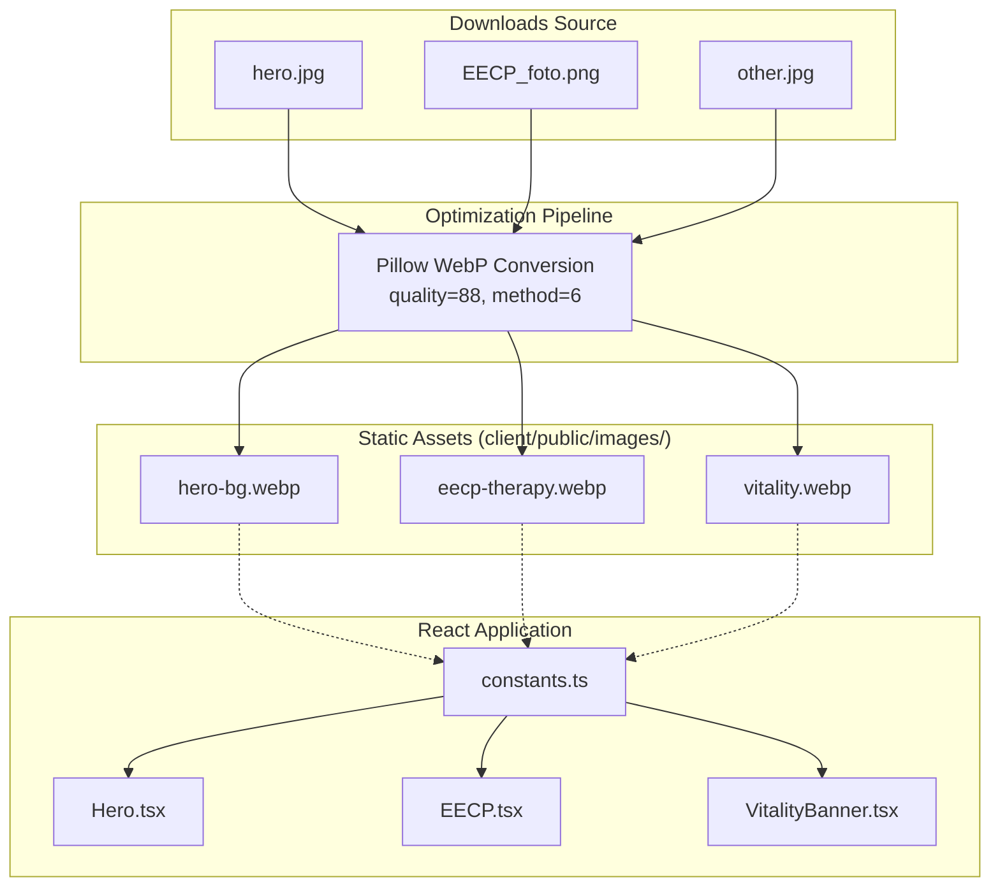

# Missing Images Local Replacement Implementation Plan

> **For agentic workers:** REQUIRED SUB-SKILL: Use superpowers:subagent-driven-development to implement this plan task-by-task. Steps use checkbox (`- [ ]`) syntax for tracking.

**Goal:** Replace broken external CloudFront CDN image links with locally optimized, high-performance WebP assets in `client/public/images/` and update references across the site.

**Architecture:** Downloaded raw high-res images (`hero.jpg`, `EECP_foto.png`, `other.jpg`) are converted via Pillow into compressed WebP images maintaining aspect ratio and visual fidelity. Section constants in `client/src/sections/constants.ts` are re-pointed from expired CloudFront URLs to local `/images/` paths, enabling Vite to bundle and deploy them statically.

**Architecture Diagram:**



**Tech Stack:** TypeScript, React, Vite, Tailwind CSS, Python (Pillow) for asset optimization, Vitest.

## Global Constraints
- All images must be self-contained in `client/public/images/`.
- No external CDN dependencies for core visuals.
- Image quality target: WebP 85–88% quality, keeping total transfer size under 1 MB across all 3 images.
- All checks must pass before pushing (`pnpm check`, `pnpm test`, `pnpm build`).
- Single clean git commit pushed to `origin/main`.

---

### Task 1: Convert & Optimize Source Images to WebP

**Files:**
- Read: `/home/milan/Downloads/hero.jpg`
- Read: `/home/milan/Downloads/EECP_foto.png`
- Read: `/home/milan/Downloads/other.jpg`
- Create: `client/public/images/hero-bg.webp`
- Create: `client/public/images/eecp-therapy.webp`
- Create: `client/public/images/vitality.webp`

**Interfaces:**
- Produces:
  - `client/public/images/hero-bg.webp` (2608×1600 WebP)
  - `client/public/images/eecp-therapy.webp` (1776×2235 WebP)
  - `client/public/images/vitality.webp` (3168×1344 WebP)

- [ ] **Step 1: Execute Python optimization script to convert images to WebP**

```bash
python3 -c "
from PIL import Image
import os

images = [
    ('/home/milan/Downloads/hero.jpg', 'client/public/images/hero-bg.webp'),
    ('/home/milan/Downloads/EECP_foto.png', 'client/public/images/eecp-therapy.webp'),
    ('/home/milan/Downloads/other.jpg', 'client/public/images/vitality.webp'),
]

os.makedirs('client/public/images', exist_ok=True)

for src, dest in images:
    with Image.open(src) as im:
        rgb_im = im.convert('RGB')
        rgb_im.save(dest, 'WEBP', quality=88, method=6)
        size_kb = os.path.getsize(dest) / 1024
        print(f'Converted {src} -> {dest} ({rgb_im.size[0]}x{rgb_im.size[1]}, {size_kb:.1f} KB)')
"
```

- [ ] **Step 2: Verify generated image sizes and formats**

```bash
ls -lh client/public/images/*.webp
file client/public/images/*.webp
```
Expected: All 3 WebP files exist, are valid WebP image data, and each file is between 100 KB and 400 KB.

---

### Task 2: Update Image Constants & Clean Up

**Files:**
- Modify: `client/src/sections/constants.ts`

**Interfaces:**
- Exports:
  - `HERO_BG: string = "/images/hero-bg.webp"`
  - `EECP_THERAPY: string = "/images/eecp-therapy.webp"`
  - `VITALITY: string = "/images/vitality.webp"`

- [ ] **Step 1: Update constants.ts with local image paths**

```diff
-export const HERO_BG = "https://d2xsxph8kpxj0f.cloudfront.net/310519663298280686/Sf6ssfRDLMCQonDWzyrzh7/hero-bg-HmsnhVnUjSPEVQXo3Pti9u.webp";
-export const EECP_THERAPY = "https://d2xsxph8kpxj0f.cloudfront.net/310519663298280686/Sf6ssfRDLMCQonDWzyrzh7/eecp-therapy-VpfLnvTXXmi5yzsMDsHJVL.webp";
-export const HEART_HEALTH = "https://d2xsxph8kpxj0f.cloudfront.net/310519663298280686/Sf6ssfRDLMCQonDWzyrzh7/heart-health-Nt5b8X49SrKsB9JXQBQCVS.webp";
-export const VITALITY = "https://d2xsxph8kpxj0f.cloudfront.net/310519663298280686/Sf6ssfRDLMCQonDWzyrzh7/vitality-39GcfBFreDwU2fSGSd7ZuQ.webp";
+export const HERO_BG = "/images/hero-bg.webp";
+export const EECP_THERAPY = "/images/eecp-therapy.webp";
+export const VITALITY = "/images/vitality.webp";
```

- [ ] **Step 2: Verify TypeScript compilation**

```bash
pnpm check
```
Expected: `tsc --noEmit` exits with 0 errors.

---

### Task 3: Build & Automated Verification

**Files:**
- Test: Vitest test suite (`pnpm test`)
- Build: Production bundle (`pnpm build`)

- [ ] **Step 1: Run unit tests**

```bash
pnpm test
```
Expected: 18 test files passed (56+ tests).

- [ ] **Step 2: Run production build**

```bash
pnpm build
```
Expected: Build passes, `dist/public/images/` contains `hero-bg.webp`, `eecp-therapy.webp`, `vitality.webp`.

- [ ] **Step 3: Verify assets in dist output**

```bash
ls -lh dist/public/images/*.webp
```
Expected: Output files present and sized appropriately in production output.

---

### Task 4: Git Commit & Push to Main

**Files:**
- Stage: `client/public/images/hero-bg.webp`, `client/public/images/eecp-therapy.webp`, `client/public/images/vitality.webp`, `client/src/sections/constants.ts`, `docs/superpowers/plans/2026-09-29-missing-images-replacement.md`

- [ ] **Step 1: Check git diff and untracked files**

```bash
git status
```

- [ ] **Step 2: Create atomic commit and amend with spec/plan or create single clear commit**

```bash
git add client/public/images/ client/src/sections/constants.ts docs/superpowers/plans/
git commit -m "feat: replace missing CloudFront images with locally optimized WebP assets"
```

- [ ] **Step 3: Push to remote origin/main**

```bash
git push origin main
```
Expected: `To github.com:MilanLR/body-flow.git main -> main`
